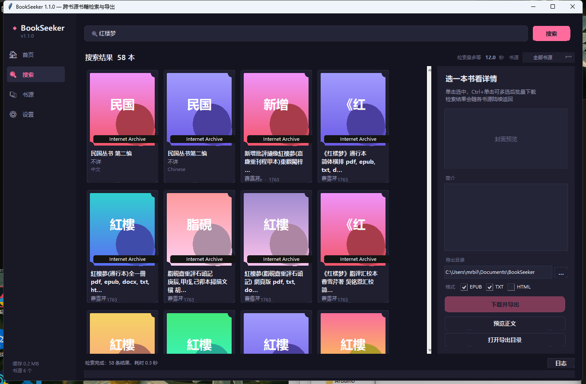

# BookSeeker

> 跨书源书籍检索与导出工具 —— 输入一个关键字，在多个合法免费书源里同时找书，预览后一键导出 **EPUB / TXT / HTML**。

纯 Python 标准库实现，**零第三方依赖**，下载即可运行。自带桌面图形界面，也支持命令行批量脚本。




---

## 目录

- [它能做什么](#它能做什么)
- [快速开始](#快速开始)
- [图形界面](#图形界面)
- [命令行用法](#命令行用法)
- [内置书源](#内置书源)
- [导出格式](#导出格式)
- [写自己的书源（插件）](#写自己的书源插件)
- [配置与缓存](#配置与缓存)
- [常见问题](#常见问题)
- [关于书源与版权](#关于书源与版权)
- [项目结构](#项目结构)
- [开发者注意](#开发者注意)

---

## 它能做什么

- **暗色卡片式界面**：首页展示精选热门书单，搜索结果以封面卡片呈现，支持分类筛选与多选批量下载。
- **多源并发检索**：一个字，同时查 Project Gutenberg、维基文库、青空文庫、Internet Archive 等，
  结果**边返回边显示**；有全局超时（默认 12 秒），慢源不会拖住整个检索。
- **缺章不会静默丢弃**：抓失败的章节会以占位段落保留在原位置，导出的文件头部也会标注，
  重新下载时已成功的章节走缓存，只补抓缺的那几章。
- **中文 / 日文 / 英文关键字都行**，繁体简体混着搜也能用。
- **先预览再下载**：拿到目录和正文开头，确认是你想要的那本。
- **导出 EPUB / TXT / HTML**：
  - EPUB 是标准 EPUB 3，同时带 EPUB 2 的 `toc.ncx`，新旧阅读器（Apple Books、Calibre、多看、微信读书、Send-to-Kindle）都能正确识别目录；
  - TXT 可选编码（UTF-8 / 带 BOM / GB18030）和按显示宽度折行；
  - HTML 是单文件，双击就能在浏览器里看。
- **可插拔书源**：内置书源之外，写个几十行的 Python 插件就能接自己的来源。
- **批量下载**：列表里多选，一次导出好几本。

---

## 检索速度

检索是**并发 + 增量**的：每个书源一返回，结果就立刻出现在界面上，不用等最慢的那个。

实测单个书源的冷缓存耗时：

| 书源 | 耗时 |
| --- | --- |
| Internet Archive | ~1.0 s |
| Standard Ebooks | ~1.4 s |
| 维基文库 | ~1.5 s |
| 青空文庫 | ~1.3 s |
| Project Gutenberg（Gutendex） | 16 s 起，中文关键字更慢 |

问题很明显：**一个慢源会拖住整个检索**。所以加了「检索最多等 N 秒」（默认 12 秒，可在设置里改）：

- 到点就用**已经拿到的结果**返回，还在跑的源算超时并在日志里标出；
- 绝不因为超时丢掉已经收到的书；
- 超时的线程会在后台自己结束，不会让程序卡住不退出。

## 章节完整性

维基文库这类站点是逐页请求的，抓 100 多章的长篇时会撞上限流（实测单章正常 0.8 秒，
但偶发的 429 会被强制等待约 34 秒），因此**个别章节抓失败是常态**。

早期的做法是「抓不到就跳过」，结果是用户拿到一本**章节不全的电子书，而且不知道少了什么**。
现在的做法是：

1. **章数恒等于目录章数**——抓失败的章用占位段落顶替，位置和标题都保留：

   > ⚠ 本章（第042回）本次抓取失败，通常是站点限流导致的。
   > 已成功抓取的章节会缓存在本地，稍后重新下载这本书时不会重复下载。

2. **导出产物里明确标注**——TXT 的文件头与结尾、EPUB 的扉页与 `dc:description`、
   单文件 HTML 的顶部都会写上「有 N 章抓取失败」；没有缺章时一个字都不出现。
3. **界面会提醒**——预览窗口顶部有橙色告警条；下载完成后状态栏也会提示。
4. **重试补齐**——重新下载同一本书时，已成功的章节直接走本地缓存，
   只会重新抓缺的那几章，通常几秒就能补齐。

---

## 快速开始

### 环境要求

只需要 **Python 3.10 或更高版本**（推荐 3.11+）。**不需要 pip install 任何东西。**

Windows 上如果还没装 Python：去 <https://www.python.org/downloads/> 下载安装，
安装时**记得勾选 `Add python.exe to PATH`**。

### 启动

**方式一（Windows，最简单）**：双击 `启动 BookSeeker.bat`。

**方式二（通用）**：在项目目录里执行

```bash
python BookSeeker.py
```

### 方式三：免安装 exe（不用装 Python）

如果你拿到的是打包好的 `BookSeeker.exe`，**双击就能用**，目标电脑不需要安装 Python，
也不需要任何依赖：

| 文件 | 用途 |
| --- | --- |
| `BookSeeker.exe` | 双击启动图形界面 |
| `BookSeeker-cli.exe` | 在 cmd / PowerShell 里使用命令行 |

程序数据（配置、缓存、插件、日志）默认放在 **exe 同级的 `BookSeeker-data\` 目录**里，
所以整个文件夹拷到 U 盘或另一台电脑，设置和缓存会一起带走。
如果 exe 所在位置不可写（比如放在 `C:\Program Files`），会自动改用
`%LOCALAPPDATA%\BookSeeker\`。也可以用环境变量 `BOOKSEEKER_HOME` 指定。

> 单文件 exe 每次启动都会把自己解压到 `%TEMP%`，在极少数「临时目录禁止写入」
> 的受限环境里可能起不来（报 `Failed to extract ... Permission denied`）。
> 遇到这种情况请改用源码方式运行，或者自己用 `--onedir` 打一个文件夹版本。

两种方式都会打开图形界面。想用命令行就直接加参数，见[命令行用法](#命令行用法)。

**不想先跑程序？** 直接看 [`samples/`](samples/) 目录 —— 里面是从真实书源导出的成品
（《红楼梦》120 回 EPUB、坊っちゃん、Pride and Prejudice 等），双击就能打开检验效果。

---

## 图形界面

```
┌──────────────────────────────────────────────────────────────┐
│ 搜索：[ 红楼梦            ] [搜索]  来源[全部书源] 每源条数[30] │
├────────────────────────────────┬─────────────────────────────┤
│ #  书名      作者    语言  来源 │ 红楼梦                      │
│ 1  红楼梦    曹雪芹  中文  维基 │ 作者：曹雪芹  语言：中文     │
│ 2  红楼梦    曹雪芹  中文  古腾 │ 来源：维基文库              │
│ ...                            │ ┌─────────────────────────┐ │
│                                │ │ 简介文本…               │ │
│                                │ └─────────────────────────┘ │
│                                │ 导出目录 [___________][浏览] │
│                                │ 格式 ☑EPUB ☑TXT ☐HTML       │
│                                │ [下载并导出]                │
│                                │ [预览正文]                  │
├────────────────────────────────┴─────────────────────────────┤
│ 运行日志：                                                    │
│   已加载书源 6 个（启用 6 个）：…                              │
│   开始检索：红楼梦                                            │
│   检索完成，共 42 条结果，耗时 3.2 秒。                        │
├──────────────────────────────────────────────────────────────┤
│ 状态栏                                                        │
└──────────────────────────────────────────────────────────────┘
```

几个操作要点：

| 想做的事 | 怎么做 |
| --- | --- |
| 检索 | 输入关键字 → 回车，或点「搜索」 |
| 只看某个源 | 右上角「来源」下拉框 |
| 下载一本 | 双击结果行，或选中后点「下载并导出」 |
| 批量下载 | `Ctrl` / `Shift` 多选，再点「下载并导出」 |
| 先看内容 | 选中 → 「预览正文」→ 左侧点章节 |
| 排序 | 点表头（书名 / 作者 / 语言 / 来源 / 年份） |
| 换导出目录 | 右侧「浏览…」，或菜单「工具 → 设置」 |
| 管理书源 / 插件 | 菜单「工具 → 书源管理」 |
| 清缓存 | 菜单「工具 → 清空网络缓存」 |

---

## 命令行用法

```
python BookSeeker.py                    # 启动图形界面
python BookSeeker.py search 红楼梦       # 检索
python BookSeeker.py get 1              # 下载上一次检索的第 1 条
python BookSeeker.py sources            # 列出所有书源
```

### `search` —— 检索

```bash
python BookSeeker.py search "夏目漱石"
python BookSeeker.py search pride --limit 10
python BookSeeker.py search 三国 -s wikisource        # 只搜维基文库
python BookSeeker.py search dickens --json > r.json   # 输出 JSON，方便脚本处理
```

| 参数 | 说明 |
| --- | --- |
| `-n, --limit` | 每个书源最多返回多少条，默认 20 |
| `-s, --source` | 只检索指定书源，可重复指定 |
| `--json` | 以 JSON 输出 |

检索结果会存到配置目录的 `last_search.json`，好让 `get` 能用序号引用。

### `get` —— 下载并导出

```bash
python BookSeeker.py get 1                            # 上一次检索的第 1 条
python BookSeeker.py get 1 3 5 -f epub,txt            # 一次下 3 本
python BookSeeker.py get gutenberg:1342 -o D:\books   # 直接按 source:uid 下载
python BookSeeker.py get --all -f epub                # 把上一次检索结果全下了
```

| 参数 | 说明 |
| --- | --- |
| `-f, --format` | 导出格式，逗号分隔：`epub,txt,html`（默认 `epub,txt`） |
| `-o, --out` | 导出目录，默认用设置里的下载目录 |
| `--all` | 下载上一次检索的全部结果 |

### `sources` —— 查看书源

```bash
python BookSeeker.py sources
python BookSeeker.py sources --reload    # 重新扫描插件目录
```

---

## 内置书源

| id | 名称 | 内容 | 语言 |
| --- | --- | --- | --- |
| `gutenberg` | Project Gutenberg | 7 万+ 公有领域电子书，含少量中文古籍 | 多语言 |
| `standard_ebooks` | Standard Ebooks | 精校排版的公有领域英文书 | 英 |
| `wikisource` | 维基文库 Wikisource | 公版原文，中文古籍/日文近代文学/英文经典 | 中 / 日 / 英 |
| `aozora` | 青空文庫 | 日本公有领域文学（夏目漱石、太宰治…） | 日 |
| `archive_org` | Internet Archive | 扫描件 OCR 全文（只收开放取用的） | 多语言 |
| `openlibrary` | Open Library | 书目元数据，能定位到开放全文时可直接下（**默认关闭**，见下） | 多语言 |
| `local` | 本地书库（示例插件） | 把你自己文件夹里的 epub/txt 当书源 | 任意 |

> 书源状态可以在「工具 → 书源管理」里查看：哪个加载失败了、失败原因是什么，都会列出来。
> 网络不通的书源不会影响其它书源，检索照常返回结果。
>
> **Open Library 为什么默认关闭？** 它只提供书目元数据，而且在部分网络环境下 TLS 握手会失败，
> 每次检索都要白白等十几秒才返回空结果。想要的人可以在「工具 → 书源管理」里双击把它打开。

---

## 导出格式

### EPUB

标准 **EPUB 3.0**，同时生成 EPUB 2 兼容的 `toc.ncx`。包含：

- 元数据：书名、作者、语言、来源、版权、主题、日期、唯一标识（`urn:uuid:`，按内容稳定生成）
- 层级目录（`nav.xhtml` + `toc.ncx`）
- 内置排版 CSS（衬线字体、首行缩进、中日韩断行友好）
- 封面（如果书源提供）
- 扉页（书名 / 作者 / 来源 / 字数）

相关设置：

| 配置项 | 默认 | 说明 |
| --- | --- | --- |
| `epub_include_cover` | `true` | 是否包含封面 |
| `epub_split_chapters` | `true` | 每章一个 xhtml 文件（兼容性最好） |
| `epub_include_source_link` | `true` | 扉页是否带来源链接和字数统计 |

### TXT

带文件头（书名 / 作者 / 来源 / 原文链接 / 字数），章节之间用分隔线隔开。

| 配置项 | 默认 | 说明 |
| --- | --- | --- |
| `txt_encoding` | `utf-8` | 也可以选 `utf-8-sig`（带 BOM，Windows 记事本更友好）或 `gb18030`（老设备兼容） |
| `txt_wrap_width` | `0` | `0` = 不自动换行，交给阅读器排版；设成 `40` 之类会按**显示宽度**折行（一个汉字算 2） |
| `txt_chapter_separator` | `true` | 章节之间是否插分隔线 |

### HTML

单文件，自带样式和目录锚点，双击用浏览器打开即可。适合快速检查或分享。

---

## 写自己的书源（插件）

内置书源覆盖的是**公有领域和明确开放取用**的资源。如果你想要的来源不在里面，可以自己写插件。

### 插件放在哪

```
%LOCALAPPDATA%\BookSeeker\plugins\      (Windows)
~/.bookseeker/plugins/                  (macOS / Linux)
```

界面上「工具 → 书源管理 → 打开插件目录」可以直接打开它。
程序每次启动会自动加载该目录下所有 `.py` 文件；点「安装示例插件」会放一个可运行的模板进去。

### 最小可运行示例

```python
from bookseeker.models import Book, BookContent, Chapter
from bookseeker.sources.base import Source, SourceError
from bookseeker.convert import htmlutil


class MySource(Source):
    id = "my_source"              # 唯一 id
    name = "我的书源"              # 界面上显示的名字
    homepage = "https://example.com"
    description = "一句话说明"
    languages = ("zh",)
    priority = 50                 # 越小排越前

    def search(self, query: str, limit: int = 20) -> list[Book]:
        """只返回元数据，别在这里下正文。"""
        r = self.get_json("https://example.com/api/search?q=%s" % self.quote(query))
        books = []
        for item in r.get("items", [])[:limit]:
            books.append(self.make_book(
                uid=item["id"],
                title=item["title"],
                authors=[item["author"]],
                language="zh",
                url=item["url"],
                description=item.get("summary", ""),
            ))
        return books

    def fetch(self, book: Book, progress=None) -> BookContent:
        """下载并解析正文。"""
        html = self.get_text(book.url)
        node = htmlutil.pick_content(html, "div#content", "article")
        if node is None:
            raise SourceError("没找到正文容器")
        return BookContent(
            title=book.title,
            authors=list(book.authors),
            language="zh",
            chapters=[Chapter(title=book.title, html=htmlutil.sanitize_to_xhtml(node))],
            source_name=self.name,
            source_url=book.url,
        )


# 也可以写成 SOURCES = [MySource, AnotherSource]
```

### 可用的工具（都来自本项目，不用额外装东西）

| 用途 | 用什么 |
| --- | --- |
| 发 HTTP 请求 | `self.get(url)` / `self.get_text(url)` / `self.get_json(url)`，自带重试、编码嗅探、磁盘缓存、同域限速 |
| 解析 HTML | `from bookseeker import htmldom`；`htmldom.parse(html).find_all("div.item > a.title")`，支持 `.class`、`#id`、`[attr=val]`、空格（后代）、`>`（子元素） |
| 提取正文容器 | `htmlutil.pick_content(html, "div#content", "article")` |
| 清洗成合法 XHTML | `htmlutil.sanitize_to_xhtml(node)` —— 去脚本、过滤属性、解包非法标签 |
| HTML → 纯文本 | `htmlutil.html_to_text(html)` |
| 纯文本 → XHTML | `htmlutil.text_to_xhtml(text)`，自动按空行分段、中日韩不补空格 |
| 解析下载到的 EPUB | `from bookseeker.epubread import read_epub`；`read_epub(bytes) -> BookContent` |
| 语言名 | `models.language_label("ja")` → `日语` |

### 约定和注意事项

1. **只写 `search()` 和 `fetch()`**，其它都是可选的。
2. `search()` **不要抛异常**，出错就返回 `[]`；`fetch()` 用 `SourceError` 报告可读的失败原因。
3. `progress` 回调签名是 `(已完成, 总数, 说明文字)`，用 `self.report(progress, done, total, "…")` 调用。
4. 章节正文必须是**良构的 XHTML 片段**，用 `sanitize_to_xhtml` 或 `text_to_xhtml` 生成，不要直接把网页 HTML 塞进去。
5. 书名里带 `/ : * ? " < > |` 之类的字符会被自动替换，不用自己处理。
6. **请自行确认目标站点的版权状态和 `robots.txt` 约定。** 程序的 HTTP 客户端默认对同一域名限速（最小间隔 0.4 秒），别把它绕过去。

完整的可运行例子见 [`bookseeker/examples/example_source.py`](bookseeker/examples/example_source.py)，
它把「本地文件夹里的 epub/txt」实现成了一个书源，很适合照着改。

---

## 配置与缓存

所有数据都在一个「家目录」下：

| 平台 | 位置 |
| --- | --- |
| Windows | `%LOCALAPPDATA%\BookSeeker\` |
| macOS / Linux | `~/.bookseeker/` |

可以用环境变量 `BOOKSEEKER_HOME` 覆盖。

```
BookSeeker/
├── config.json          # 设置（界面上改了会自动保存）
├── cache/http/          # 网络缓存（默认 7 天过期，可一键清空）
├── plugins/             # 你的书源插件
├── library/             # 「本地书库」示例插件扫描的目录
├── last_search.json     # 上一次检索结果（命令行 get 用）
└── bookseeker.log
```

主要配置项（也可以直接编辑 `config.json`）：

| 键 | 默认 | 说明 |
| --- | --- | --- |
| `download_dir` | `~/Documents/BookSeeker` | 默认导出目录 |
| `formats` | `["epub", "txt"]` | 默认勾选的导出格式 |
| `max_results_per_source` | `30` | 每个书源最多返回多少条 |
| `timeout` / `retries` | `30` / `3` | 请求超时与重试 |
| `proxy` | `""` | 例如 `http://127.0.0.1:7890`，留空则读环境变量 |
| `request_interval` | `0.4` | 同一域名两次请求的最小间隔（秒） |
| `cache_enabled` / `cache_ttl_days` | `true` / `7` | 网络缓存开关与有效期 |
| `disabled_sources` | `[]` | 想临时关掉某些书源就填它们的 id |
| `window_geometry` | `1220x780` | 窗口大小与位置 |

---

## 常见问题

**Q：下载完提示「有 N 章抓取失败」怎么办？**

不是 bug，是站点限流。正文里那些章已经用占位段落标出，直接**再下载一次**同一本书就行——
已成功的章节走本地缓存不会重复下载，只会补抓缺的那几章。也可以把「设置 → 检索」
里相关的等待放宽，或者换个时间段再试。

**Q：为什么有些书搜到了却下载失败？**

不同书源的限制不一样。Internet Archive 上很多书是「借阅制」（只能在线看，不能下载），
这类书会明确报错 `这本书在 Internet Archive 上不提供开放全文下载（可能是借阅制）`。
换个书源再试试，或者用「预览正文」先看看能不能拿到内容。

**Q：检索很慢 / 某个书源一直失败？**

- 单源失败不影响整体：日志里会写 `⚠ xxx 检索失败：...`，其它书源照常出结果。
- 网络不通的书源可以在「工具 → 书源管理」里双击禁用掉。
- 如果整体都很慢，检查一下「工具 → 设置」里的超时和代理设置。
- 已经搜过的关键字第二次会快很多（走本地缓存）。

**Q：导出的 EPUB 在某些阅读器里目录是空的？**

本工具同时写了 EPUB 3 的 `nav.xhtml` 和 EPUB 2 的 `toc.ncx`，绝大多数阅读器都没问题。
如果遇到特别老的阅读器，把「工具 → 设置 → EPUB 每章一个文件」勾上再导出一次试试。

**Q：TXT 在 Windows 记事本里打开是乱码？**

把「工具 → 设置 → TXT 编码」改成 `utf-8-sig`（带 BOM）或 `gb18030`。

**Q：怎么把书名里的方括号、引号处理干净？**

不用管。文件名会自动替换掉 `\ / : * ? " < > |` 这些非法字符。

**Q：能加某点、某轻小说站吗？**

见下一节。

---

## 关于书源与版权

这个工具**只内置公有领域（Public Domain）、CC 授权或明确开放取用**的书源：

- **Project Gutenberg** —— 版权过期的公版书，明确允许自由下载再分发
- **Standard Ebooks** —— 对公版书的精校排版，同样自由
- **维基文库** —— 公版原文，CC BY-SA
- **青空文庫** —— 日本版权过期的文学作品
- **Internet Archive / Open Library** —— 只取其中标记为开放取用的部分

**没有内置任何盗版站点、付费内容绕过或需要登录才能看的资源。**
起点、晋江、轻之国度这类站点的作品绝大多数仍在版权保护期内，
未经授权抓取和分发属于侵权行为，所以这个工具不做这件事，也不提供绕过手段。

需要别的来源，请自己写插件（能力已经开放了），并且**自行确认目标站点的版权状态和 robots 约定**。
请尊重作者和出版方。

---

## 项目结构

```
BookSeeker/
├── BookSeeker.py                 # 启动入口（图形界面 / 命令行）
├── 启动 BookSeeker.bat            # Windows 双击启动
├── README.md
├── make_samples.py               # 重新生成 samples/ 里的示例成品
├── build_exe.bat                 # 一键打包免安装 exe
├── BookSeeker.spec               # PyInstaller 打包配置
├── docs/screenshot-gui.png       # 界面截图
├── samples/                      # 示例导出（真实成品，可直接打开）
├── bookseeker/
│   ├── config.py                 # 配置与路径
│   ├── models.py                 # Book / Chapter / BookContent
│   ├── http.py                   # HTTP 客户端：重试、编码嗅探、缓存、限速
│   ├── htmldom.py                # 轻量 DOM + CSS 选择器（替代 bs4/lxml）
│   ├── epubread.py               # EPUB 读取器（把下载到的 epub 解析成章节）
│   ├── exporter.py               # 导出调度
│   ├── cli.py                    # 命令行界面
│   ├── gui.py                    # 图形界面入口（转接到 ui/）
│   ├── hotlist.py                # 首页「热门书籍」精选书单 + 磁盘缓存
│   ├── ui/                       # 暗色卡片式界面（自绘控件，零依赖）
│   │   ├── theme.py              # 配色、字体、DPI 缩放、渐变与圆角绘制
│   │   ├── widgets.py            # 书卡、胶囊按钮、开关、滚动容器
│   │   ├── dialogs.py            # 设置 / 书源管理 / 正文预览
│   │   └── app.py                # 主窗口与各页面
│   ├── convert/
│   │   ├── htmlutil.py           # HTML 清洗 / 文本互转
│   │   ├── epub.py               # EPUB 3 生成器（手写 OPF/NAV/NCX）
│   │   ├── txt.py                # TXT 生成（按显示宽度折行）
│   │   └── htmlout.py            # 单文件 HTML 生成
│   ├── sources/
│   │   ├── base.py               # Source 基类 + 相关度排序
│   │   ├── registry.py           # 书源注册表、插件加载、并发检索
│   │   ├── gutenberg.py          # 各内置书源…
│   │   ├── standard_ebooks.py
│   │   ├── wikisource.py
│   │   ├── aozora.py
│   │   ├── archive_org.py
│   │   └── openlibrary.py
│   └── examples/
│       └── example_source.py     # 可运行的插件模板（本地书库）
└── tests/                        # 测试脚本（run_all.py 一键跑全部）
```

---

## 开发者注意

### 设计取舍

- **零依赖**：不用 `requests` / `beautifulsoup4` / `lxml` / `ebooklib`，全部用标准库重写了一遍
  （`http.py` 顶 requests，`htmldom.py` 顶 bs4，`convert/epub.py` 顶 ebooklib）。
  代价是功能没那些库全，好处是**下载即用、不会因为依赖装不上而跑不起来**。
- **EPUB 手写**：EPUB 本质就是个带 `mimetype` 的 zip，手写 OPF/NAV/NCX 完全可控，
  生成的包同时兼容 EPUB 2 和 EPUB 3。
- **先下 EPUB 再解析**：对 Project Gutenberg 这类本身提供高质量 EPUB 的源，
  下载现成的 EPUB（用无图版，`pgNNNN.epub.noimages`，通常几百 KB）然后解析，
  比自己啃纯文本、猜章节切分可靠得多。

### 跑测试

```bash
python tests/run_all.py          # 一键跑全部（含真实联网的端到端测试）
python tests/run_all.py --offline # 只跑不联网的单元测试

# 也可以单独跑：
python tests/test_http.py        # HTTP 层 + 编码嗅探
python tests/test_htmldom.py     # DOM 与选择器
python tests/test_htmlutil.py    # HTML 清洗与转换
python tests/test_export.py      # EPUB/TXT/HTML 生成与结构校验
python tests/test_epubread.py    # EPUB 读取
python tests/test_end_to_end.py  # 端到端：每个书源真实检索→下载→导出→校验
```

测试脚本会真实联网（`test_http.py`、`test_epubread.py`、`test_end_to_end.py`），
导出产物写在 `tests/_out/`。`test_end_to_end.py` 会对每个书源做
**检索 → 下载 → 导出 EPUB/TXT/HTML → 校验 zip 结构、mimetype、XHTML 良构性、目录** 共 33 项检查。

### 打包免安装 exe

```bash
build_exe.bat
```

脚本会自动把 PyInstaller 装到 `.build\pylibs`（不污染系统 Python），
然后产出 `dist\BookSeeker.exe` 与 `dist\BookSeeker-cli.exe`。

打包时有两个坑值得记住：

1. **动态导入的书源必须列进 `hiddenimports`。** `registry.load_builtins()` 是用
   `importlib.import_module()` 按名字加载书源的，PyInstaller 的静态分析看不到它们，
   不显式声明的话打出来的 exe 会「一个内置书源都加载不到」，而且完全不报错。
2. **GUI 程序要分成两个 exe。** Windows 的 GUI 子系统程序不会阻塞调用它的 shell，
   在终端里 `BookSeeker.exe sources > out.txt` 会立刻返回、输出也可能丢失，
   所以命令行场景单独给了控制台版的 `BookSeeker-cli.exe`。

### 加一个内置书源

1. 在 `bookseeker/sources/` 下新建 `your_source.py`，实现一个 `Source` 子类；
2. 把模块名加进 `bookseeker/sources/registry.py` 的 `BUILTIN_SOURCES` 元组；
3. 重启程序即可。

单个内置模块导入失败不会影响其它书源，`BookSeeker.py sources` 会列出失败原因。

---

## 许可证

本项目**源代码**采用 [MIT 许可证](LICENSE)。

[`samples/`](samples/) 目录里是通过各书源下载的电子书成品，它们来自公有领域或
明确开放取用的资源（Project Gutenberg、维基文库、青空文庫、Standard Ebooks、
Internet Archive），各有自己的授权条款，**不受 MIT 许可证约束**。
